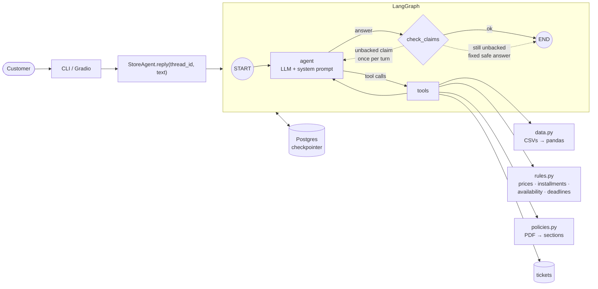

# 🎸 Empório da Música — AI customer-service agent

Prototype of a text-message assistant for **Empório da Música**, a (fictional) musical-instrument
store in Campo Grande/MS. It answers customers in Brazilian Portuguese, looks up **live data**
(catalog, prices, stock, promotions, orders) and **store policies** (hours, payment, returns,
shipping, warranty) through tools, and declines what is out of scope.

Built for the Artefact **Senior AI Engineer** technical case.

| | |
|---|---|
| **Stack** | Python 3.12 · LangGraph · LangChain tools · Ollama (local) / OpenAI / Gemini (cloud) · Postgres · Gradio · uv |
| **Interfaces** | Terminal chat (`emporio-chat`) and web chat (`emporio-web`) |
| **Quality** | 83 offline unit tests · 20-case LLM eval suite run on 4 models · CI on every PR |
| **Examples** | [`examples/`](examples/) — 5 generated conversations |

---

## Contents

1. [Quick start](#1-quick-start)
2. [How it works](#2-how-it-works)
3. [Technical decisions](#3-technical-decisions)
4. [Evaluation](#4-evaluation)
5. [Example conversations](#5-example-conversations)
6. [Assumptions](#6-assumptions)
7. [Known limitations and next steps](#7-known-limitations-and-next-steps)
8. [AI coding assistant usage](#8-ai-coding-assistant-usage)
9. [Project structure](#9-project-structure)

---

## 1. Quick start

**Requirements:** [uv](https://docs.astral.sh/uv/) (installs Python 3.12 automatically). Optional:
Docker (Postgres history and/or Ollama), an OpenAI API key.

```bash
git clone https://github.com/matheusm-luz/emporio-musica-ai-agent.git
cd emporio-musica-ai-agent
uv sync
cp .env.example .env        # then pick ONE model option below
```

### Choose the model (one variable: `LLM_MODEL`)

| Option | `.env` | Cost | Notes |
|--------|--------|------|-------|
| **A. OpenAI** (fastest to set up) | `LLM_MODEL=openai:gpt-6-luna`<br>`OPENAI_API_KEY=sk-...` | paid API | "Production" model |
| **B. Gemini free tier** (cloud, no credit card) | `LLM_MODEL=gemini:gemini-3.8-flash`<br>`GEMINI_API_KEY=...` | free | Key from [Google AI Studio](https://aistudio.google.com). On the free tier Google may use the content to improve its products — fine for this fictional data, not for real customers |
| **C. Ollama in Docker** (NVIDIA GPU) | `LLM_MODEL=ollama:gemma4:12b` | free | `docker compose --profile ollama-gpu up -d` — pulls the model on first start (~8 GB) |
| **D. Ollama in Docker** (CPU only) | `LLM_MODEL=ollama:gemma4:12b` | free | `docker compose --profile ollama up -d` — works anywhere, slow |
| **E. Native Ollama** (best on macOS) | `LLM_MODEL=ollama:gemma4:12b` | free | [Install Ollama](https://ollama.com/download), then `ollama pull gemma4:12b` |

Conversation history is stored in **Postgres** when it is running (`docker compose up -d`, already
included in options C/D); otherwise the app automatically falls back to in-memory history.

### Run

```bash
uv run emporio-chat                                   # terminal chat
uv run emporio-chat --phone "(67) 98432-1098" --show-tools   # simulate an identified WhatsApp customer, show tool calls
uv run emporio-chat --session <id>                    # resume a conversation (with Postgres)
uv run emporio-web                                    # web chat on http://localhost:7860
```

Development:

```bash
uv run pytest                                         # 83 offline unit tests (no LLM, no network)
uv run python evals/run_evals.py --model <provider:model>   # LLM behaviour suite → evals/results/
uv run python scripts/run_examples.py --model <provider:model>  # regenerate examples/
```

> Phone numbers of test customers are in `data/desafio_tecnico_ai_eng - customers.csv`
> (e.g. `(67) 98432-1098` = Pedro, who has a delivered and a cancelled order).

---

## 2. How it works



1. Each customer message runs a **ReAct loop** in an explicit two-node LangGraph: the model either
   calls tools or answers. History is persisted per conversation thread by the checkpointer.
2. The **system prompt** holds only behaviour rules (persona, grounding, scope, privacy), each
   citing the manual section it comes from. It is rebuilt on every model call with the current
   time, whether the store is open (and when it reopens) and the customer's identity.
3. **Facts come only from tools**, which return compact JSON with every value already computed
   and formatted — the model relays numbers, it never calculates them.
4. **`check_claims` verifies the final answer in code:** if it says a complaint was registered or
   quotes a protocol while `create_support_ticket` did not run in that turn, the draft is dropped
   and the model is asked once to actually do it (or not claim it). If the second draft still
   claims it, a fixed safe answer (offering a human attendant) is sent instead — a false claim
   never reaches the customer.

### Tools — when the agent uses data and when it uses policies

| Tool | Used for | Source | Rules enforced in code |
|------|----------|--------|------------------------|
| `search_products` | "Which guitars under R$ 1,000?" | products, categories, promotions CSVs | only available items by default; named unavailable items are reported with their status; typo-tolerant matching |
| `get_product_details` | "How much is the Takamine GD20?" | products, promotions CSVs | active promotion → original price + %; PIX −5% only without promotion; max interest-free installments (§3.1); alternatives when out of stock / discontinued (§7.3) |
| `list_active_promotions` | "Any Black Friday deals?" | promotions CSV | only `is_active = 1` promotions exist |
| `lookup_orders` | order status, "can I return it?" | orders, items, customers CSVs | owner-only (phone or e-mail); 7/30/90-day return/defect/warranty deadlines computed from the order dates |
| `get_store_policy` | hours, address, payment, returns, shipping, warranty, privacy | policy manual PDF | official text of the relevant section |
| `create_support_ticket` | complaints, hand-off to a human | — | protocol number + 24 business-hour SLA (§7.3) |

---

## 3. Technical decisions

Each decision below lists the alternatives considered. The full requirement trace is in
[`docs/SPEC.md`](docs/SPEC.md).

### 3.1 Agent approach: function calling in an explicit LangGraph loop

- **Why function calling:** every question in the case is answered by a *bounded* set of lookups
  (catalog, order, policy). Typed tools make "when to use data vs. policies" an explicit,
  observable decision and let business rules live in tested code.
- **Why LangGraph:** industry-standard orchestration with built-in persistence (checkpointers),
  streaming and tracing (LangSmith via env vars, no code). I used an **explicit `StateGraph`**
  (two nodes) instead of the prebuilt agent so the loop is visible and the system prompt can be
  injected per call — time-sensitive context ("store closed now") never goes stale in the stored
  history. A recursion limit stops runaway tool loops.
- **Alternatives:** plain SDK loop (fewer dependencies, but persistence/tracing by hand);
  PydanticAI (nice typed tools, smaller ecosystem); **text-to-SQL agent** (rejected: lets the model
  read the customers table — LGPD risk — and makes it do price arithmetic).

### 3.2 Model and provider: one code path, local or cloud by configuration

`LLM_MODEL="<provider>:<model>"` is the only switch (`llm.py`).

- **Local (dev / zero cost / data stays on the machine): Ollama.** One-command install or a Docker
  profile; it runs on llama.cpp underneath. Plain llama.cpp was rejected for the extra friction
  (manual GGUF download, `--jinja` for tool calling). The default local model was chosen **by the
  eval suite** among three candidates that fit a 16 GB GPU — see [Evaluation](#4-evaluation).
- **Cloud ("production"): OpenAI `gpt-6-luna`**, which OpenAI's model page recommends for
  cost-sensitive, high-volume workloads ($0.10 / $0.50 per 1M input/output tokens), used with
  `reasoning_effort="none"` for chat latency (on this model, Chat Completions supports function
  calling only with that setting) and `parallel_tool_calls=False` (with parallel calls it added an
  empty product search next to multi-part store questions). `gpt-5-mini`/`gpt-5-nano` were avoided
  on purpose: they are shut down on 2026-12-11, days after this delivery.
- **Free cloud: Google Gemini (AI Studio free tier)** through its OpenAI-compatible endpoint — the
  same `ChatOpenAI` client, no extra dependency — so an evaluator can try a cloud model without a
  GPU or a paid key. Checked alternatives: Groq's free tier (8K tokens/minute is below what a single
  agent turn uses), OpenRouter `:free` models (50 requests/day), GitHub Models (retired in July 2026).

### 3.3 Retrieval architecture

- **Policies: section lookup, not embeddings.** The manual is 8 pages with 10 numbered sections.
  `policies.py` parses the PDF once (pypdf layout mode keeps table columns) and the tool returns the
  exact section for a topic. That is exact, deterministic, cheap, and makes the policy consultation
  visible. Parsing fails loudly if the structure changes. *A vector store would add chunking,
  an embedding model and recall errors for no gain at this size; it is the right move for a
  larger, unstructured corpus.*
- **Data: typed tools over pandas.** The CSVs are loaded once, cleaned in memory and validated
  (19 findings documented in [`docs/DATA_NOTES.md`](docs/DATA_NOTES.md), e.g. descriptions naming
  another brand, discontinued items with stock, order totals that do not match their items, two
  customers sharing an e-mail). Business rules from the manual are coded in `rules.py` and
  **asserted against the manual's text** in tests, so a policy change breaks the build instead of
  silently diverging.

### 3.4 Prompt strategy

- Rules in the prompt, facts in tools — the prompt contains no price, hour or address, so it cannot
  drift from the data.
- Each rule cites its source section (§7.1 tone, §7.2 flow, §7.3 special cases, §9 privacy…), which
  keeps the prompt auditable against the manual.
- Explicit grounding rule ("never state a price, stock, delivery time or order detail without
  calling a tool this turn") + "copy numbers exactly as returned".
- Written in English for reviewers; the agent answers in the customer's language (PT-BR default).
- Dynamic context per call: time in Campo Grande, open/closed + reopening time (§7.1 asks the
  virtual assistant to say when the team is back), identified customer.
- Prompt changes were driven by eval failures (see the `fix(prompts)` commits).

### 3.5 Conversation persistence

LangGraph `PostgresSaver` (Postgres via `docker compose`), keyed by conversation thread — a
customer coming back on WhatsApp keeps the context. If Postgres is not reachable the app falls back
to `InMemorySaver`, so the project runs without Docker. Support tickets live in the same database.

### 3.6 Interface

Terminal chat (focus of the case) plus a ~70-line Gradio web chat that shows each tool call as a
collapsible step — useful for demos and for seeing *why* the agent answered what it did.
`--phone` simulates the sender identity a WhatsApp integration would provide (greeting by name,
order lookup without asking again).

### 3.7 Privacy and safety

- Order data only for the matching contact; another customer's order id gets the same "not found"
  as a non-existent one; an ambiguous e-mail requires the phone number.
- The model never sees the customers table; tools return first names only.
- Prompt-injection and off-topic requests are part of the eval suite.
- **Prompts are probabilistic, so the worst failure is blocked in code.** Evals caught
  `gemma4:12b` intermittently telling a customer a complaint was registered with an invented
  protocol and deadline, even after a prompt rule against it. The `check_claims` graph node now
  rejects such an answer unless the ticket tool really ran in that turn, asks the model once to
  fix it, and otherwise sends a fixed safe answer (unit-tested; Portuguese and English phrasings).

---

## 4. Evaluation

Two layers:

- **Unit tests (83, offline, run in CI):** data loading and every data-quality finding, pricing and
  installment tiers (with edge values), promotion/PIX precedence, opening-hours messages, policy
  parsing, manual ↔ code consistency, order privacy, and the agent loop with a scripted chat model.
- **LLM eval suite** ([`evals/cases.json`](evals/cases.json), 20 cases traced to SPEC IDs): the
  case's four suggested questions plus the traps found in the data — inactive Black Friday,
  out-of-stock and discontinued items, empty categories, accessories, off-topic and
  prompt-injection requests, another customer's order, complaint ticket, store closed on Sunday,
  English-speaking customer. Each case checks the tools called, facts that must appear and claims
  that must not appear. Clock frozen at Wed 25/11/2026 10:00.

### Results (final code, one full run per model)

| Model | Runs on | Passed | Median time / case | Failed case in this run |
|-------|---------|--------|--------------------|-------------------------|
| `openai:gpt-6-luna` | OpenAI API | **20/20** | 3.5 s | — |
| `ollama:gemma4:12b` — **default local** (8 GB) | RTX 5080 16 GB | **20/20** | 3.3 s | — |
| `ollama:gpt-oss:20b` (14 GB) | RTX 5080 16 GB | 18/20 | 2.1 s | `p9_promo_installments`: installments quoted without the promotional price (fails in most runs); `a4_regret_needs_identification`: generic policy answer without asking who the customer is (passed 4/4 re-runs) |
| `ollama:qwen3:14b` (9 GB) | RTX 5080 16 GB | 18/20 | 6.4 s | `a4_regret_identified_customer`: answered without looking up the order; `a4_regret_needs_identification`: did not ask for identification |
| `gemini:gemini-3.8-flash` | Google AI Studio free tier | not run | — | requires a `GEMINI_API_KEY`; the preset is unit-tested only |

Full reports with the transcripts of every failed case: [`evals/results/`](evals/results/).

**Why `gemma4:12b` is the default local model:** the smallest footprint (8 GB — fits common GPUs),
top or tied-top pass rate in every run, and low latency. `gpt-oss:20b` has similar quality but
needs 14 GB and keeps dropping the promotional price; `qwen3:14b` repeatedly skipped order lookups
and is ~2× slower (thinking mode).
Single runs vary — a case can flip between runs — which is why the most damaging failure mode
(invented ticket protocols) is blocked in code rather than left to the prompt (§3.7).

---

## 5. Example conversations

Generated by [`scripts/run_examples.py`](scripts/run_examples.py) with the real agent (never edited
by hand); each one is validated with the eval assertions before being written.

| File | Scenario |
|------|----------|
| [01_catalog_search.md](examples/01_catalog_search.md) | Guitars up to R$ 1,000, then a beginner nylon recommendation |
| [02_store_information.md](examples/02_store_information.md) | Address, Saturday hours, WhatsApp number |
| [03_price_and_payment.md](examples/03_price_and_payment.md) | Takamine GD20 price, installments and PIX |
| [04_return_request_order_lookup.md](examples/04_return_request_order_lookup.md) | **Non-trivial:** return request on a real order + defect/warranty rules |
| [05_out_of_scope_and_promotions_english.md](examples/05_out_of_scope_and_promotions_english.md) | Accessories, inactive Black Friday, off-topic question — in English |

---

## 6. Assumptions

Where the sources are silent or contradictory, I chose a reasonable interpretation and documented
it (full list: [SPEC — Interpretations](docs/SPEC.md#interpretations-and-assumptions)). Highlights:

- **"Today"** is the real clock in Campo Grande (UTC−4); evals and examples freeze it via `AGENT_NOW`.
- **Receipt date** = the order's `estimated_delivery` (the data has no actual delivery date).
- Orders in the system are **online purchases** (they have shipping data), so the 7-day right of
  regret applies.
- **Installments:** the detailed rule §3.1 prevails over the summary table in §3.
- **Product status prevails over stock**; **name/specs prevail over a contradicting description**.
- A promotion is valid only if **active in the system** — the campaign calendar in §6.1 is not a promise.
- **Conflicting contacts** in the manual (two WhatsApp numbers) are shown as written, not picked.
- Language: deliverables in English (recruiter e-mail); the agent speaks the customer's language.

---

## 7. Known limitations and next steps

| Limitation | With more time |
|------------|----------------|
| No holiday calendar (the manual says "closed on holidays") | Add a holiday table owned by the store |
| Order identity = phone/e-mail typed by the customer | Use the authenticated WhatsApp sender id; OTP for sensitive actions |
| Eval checks are deterministic (regex/tool assertions) and each model was run once — LLM output varies between runs (a case can flip between runs) | Add an LLM-as-judge for tone/helpfulness, run each case N times and track pass@k in CI with a nightly job |
| Free cloud tier (Gemini) may use prompts to improve Google's products | Fine for this fictional data; with real customers (LGPD) use a paid tier with no data retention, or a local model |
| Shipping cost to other cities cannot be quoted (it depends on CEP/weight, per the manual) | Integrate a carrier quote API as a new tool |
| Catalog search is keyword/fuzzy | Hybrid search (keywords + embeddings) once the catalog grows past a few hundred items |
| Tickets are stored, not routed | Push tickets to the store's helpdesk / notify the team |
| Single process, one Postgres connection | Containerise the app, connection pool, deploy (e.g. Cloud Run) behind a WhatsApp Business webhook |
| No guardrail model | Add input/output moderation and PII redaction in logs |
| The claim check (`check_claims`) is pattern-based: it covers the Portuguese and English phrasings seen so far, not every paraphrase | Structured output for the final answer (a `claims_action` flag checked against the tool log) |
| Wording details still vary by run: e.g. the agent may say "recebido em" for the estimated delivery date used as the receipt date (SPEC I5), or mention "o manual" | A tone/fidelity LLM-as-judge in the eval suite; an actual delivery date in the order data |
| Data is static CSV | Replace `data.py` with a repository over the store's real database / ERP |

---

## 8. AI coding assistant usage

**Tool:** [Claude Code](https://code.claude.com) (Claude Opus 5.5) in VS Code, used for planning,
research, implementation, tests and documentation. I made every product and architecture decision;
Claude proposed options with trade-offs, implemented, and verified.

### Workflow: lightweight spec-driven development + a verification harness

I chose a *light* version of spec-driven development plus "harness engineering" (making the
environment check the AI's output automatically), instead of either vibe-coding or a full SDD
toolkit (e.g. GitHub Spec Kit, too much ceremony for a 2.5-day case):

1. **Plan mode first.** Claude read the challenge, the manual and the CSVs, surfaced conflicts
   between the sources (e-mail subject vs. role, delivery channel, language) and data traps, and
   researched the *current* model landscape (it found that `gpt-5-mini` shuts down on 2026-12-11).
   Then it asked me to decide: provider strategy, framework, retrieval approach, data access,
   persistence, interface, language, git workflow. My choices differed from its recommendation
   in three places (LangGraph over a plain SDK loop, Postgres over SQLite, adding a web UI).
2. **Spec as the contract.** [`docs/SPEC.md`](docs/SPEC.md) traces every requirement to its source
   with an ID (R*, D*, P*, A*, I*, N*), and every interpretation is written down. Tests, evals and the
   auditor below refer to these IDs.
3. **Harness — deterministic checks around the AI's output** ([`.claude/`](.claude/), [`CLAUDE.md`](CLAUDE.md)):
   - `CLAUDE.md`: project rules (sources of truth, never modify `data/`, rules in code not prompt…).
   - **Hooks:** every Python file Claude edits is formatted and linted (`ruff`); lint errors it cannot fix
     are fed back to Claude immediately. A *Stop* hook blocks Claude from ending a turn while unit
     tests fail.
   - **Source-integrity test:** checksums guarantee the provided data is never modified.
   - **Skills** `/run-evals` and `/gen-examples` standardise how evals and examples are run.
   - **Subagent `spec-auditor`** (read-only) audits code, docs and examples against the SPEC before
     milestones and before submission.
4. **Milestones as pull requests** with CI (format, lint, tests) and merge commits, so the history
   shows real progress: setup → data layer → agent → evals/UI → examples/docs.
5. **Eval-driven iteration.** Behaviour bugs were found by the eval suite, not by eyeballing, and
   fixed at the root cause — each `fix(...)` commit names the eval that caught it:
   - the search tool silently hid a discontinued item → the tool now reports it with its status
     and suggests alternatives (tool fix, not a prompt patch);
   - installments quoted without the promotional price; a Portuguese reply to an English message;
     return requests answered with the generic policy without looking up the order (gpt-oss,
     qwen3); a math equation solved by `gpt-6-luna` despite the scope rule → prompt fixes;
   - the most serious one: after a prompt change, `gemma4:12b` told a complaining customer the
     complaint "was registered" with an **invented protocol number and a wrong deadline** — without
     calling the ticket tool. The grounding rule now covers *actions*, not only facts ("never claim
     or promise an action no tool performed"); the regression was caught because every prompt
     change re-runs the full suite on all models;
   - the eval harness itself had false negatives (typographic Unicode hyphens from gpt-oss; an
     assertion that matched wording instead of intent) → fixed in the harness, documented in the
     commit messages, never by weakening what the case verifies.

6. **Review of the examples + audit before submission.** Reading the generated conversations and
   running the `spec-auditor` found issues the eval assertions did not catch, all fixed at the
   root cause and then asserted in the example generator: the agent silently picked one of the
   manual's two WhatsApp numbers (SPEC I12 → the policy tool now flags the divergence); it opened
   a support ticket for a hypothetical question and paraphrased "a maioria dos fabricantes" as
   "alguns" (→ prompt); `gpt-6-luna` added an empty product search to multi-part questions
   (→ `parallel_tool_calls=False`); a second false "registered" draft could still reach the
   customer (→ fixed safe answer); missing manual ↔ code tests for deadlines, SLA and installment
   tiers (→ added); the CLI reported Postgres history after falling back to memory (→ fixed).

What I reviewed by hand: the spec and interpretations, every data-quality decision, tool outputs
against the CSVs/manual (prices, deadlines), the prompt, and every example transcript.

---

## 9. Project structure

```
src/emporio_agent/
  config.py      settings from env; store clock (America/Campo_Grande)
  data.py        CSV loading, cleaning, validation (data-quality warnings)
  rules.py       business rules: pricing, PIX, installments, availability, hours, deadlines
  policies.py    policy PDF → numbered sections, served by topic
  tools.py       the six agent tools (pure functions + LangChain wrappers)
  tickets.py     support tickets (Postgres / in-memory)
  prompts.py     system prompt
  llm.py         model factory (ollama:* / openai:* / gemini:*)
  graph.py       LangGraph agent ⇄ tools loop
  agent.py       StoreAgent facade + persistence selection
  cli.py, web.py interfaces
tests/           83 offline unit tests
evals/           LLM eval suite + results per model
examples/        generated example conversations
scripts/         example generator
docs/            SPEC (requirements trace) and DATA_NOTES (data findings)
data/            original case files (unchanged)
.claude/         Claude Code harness: hooks, skills, spec-auditor subagent
```
